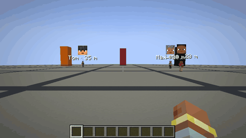
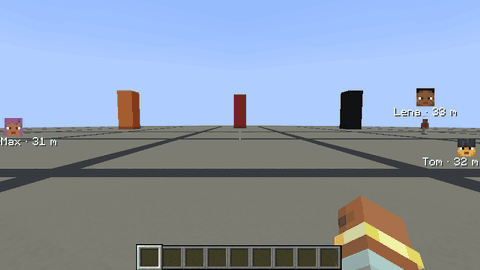
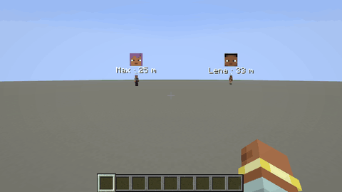
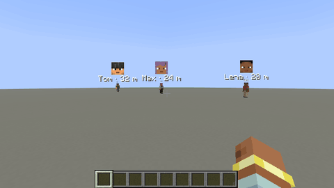

> ⚠️ **Disclaimer: This project is AI-generated.** The code, this description and the icon of this mod were created with generative AI (Claude by Anthropic), directed by me. While I am a professional software developer, I am not a Java developer, so I use generative AI to build mods that my friends and I want to play with, and I like to share the ones that work well with everyone. I understand if you do not want to support the use of generative AI, which is why I put this disclaimer here. If you run into any problems, please report them on GitHub.

# Player Icons

See at a glance where everyone else on your server is: their faces are shown right on your screen.

## Features

- While a player is **in view**, their face floats small right above them, even behind hills or far away.
- While a player is **out of view**, their face sticks to the **edge of the screen** in the direction you have to turn to see them.
- Players **close by** get no icon; beyond a configurable distance the icon **fades in**.
- **Name** and **distance** are shown below the face; face and text can be switched off and resized separately.
- **Toggle key** (`J` by default) shows and hides the icons; it can be changed in *Options → Controls → Key Binds → Multiplayer*.
- Spectators and invisible players stay hidden like in vanilla, and the icons disappear with the HUD (F1).

## Installation

Install the mod on the **client**. On Fabric, [Fabric API](https://www.curseforge.com/minecraft/mc-mods/fabric-api) is required. The **server** is optional: without the mod there, players are shown within the render distance; with it, players are shown at any distance in the same dimension. Players without the mod can still join a server with it, they just see no icons themselves.

## Configuration

`config/playericons.properties` is created on first start and reloaded automatically when it changes. It can also be edited in game: on NeoForge in *Mods → Player Icons → Config*, on Fabric through [Mod Menu](https://www.curseforge.com/minecraft/mc-mods/modmenu). Invalid values are marked red and cannot be saved, and every value can be reset to its default.

You can configure whether the icons are shown at start, show or hide the face and the text (name, distance) separately and set their sizes, choose the distance at which icons hide and fade and their opacity, and decide on the server whether positions are shared at any distance.

## Versions

Available for **Fabric** and **NeoForge** on Minecraft **1.21 – 26.3**. Download the file that matches your loader and Minecraft version.

## Links

- [Source code](https://github.com/welles/minecraft-player-icons)
- [Report a problem](https://github.com/welles/minecraft-player-icons/issues)
- [Changelog](https://github.com/welles/minecraft-player-icons/blob/main/CHANGELOG.md)
