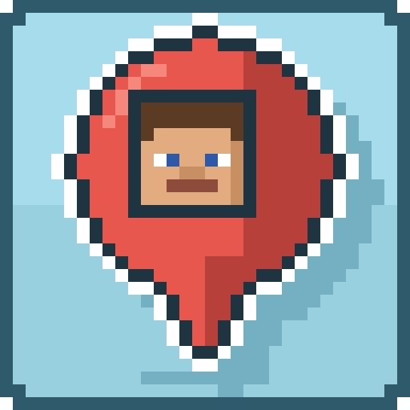

# Player Icons

A Minecraft mod for **Fabric** and **NeoForge** (Minecraft 1.21.1 – 26.3) for small multiplayer servers: it shows
where the other players are by drawing their **faces** on the screen.

- While a player is **in view**, their face floats small right above them, wherever they are, even behind hills or
  far away.
- While a player is **not in view**, their face sticks to the **edge of the screen** in the direction you have to turn
  to look at them. Players behind you show up at the side you would turn to.
- Players **close by** get no icon, you can see them anyway. Beyond a configurable distance the icon **fades in**.
- The player's **name** and **distance** in blocks are shown below the face.
- The **toggle key** (`J` by default) shows and hides the icons. The new state is shown above the hotbar.
- Spectators and invisible players are only shown to spectators, like in vanilla. The icons are hidden with the HUD
  (F1).

## Installation

The mod is needed on the **client**. On the **server** it is optional:

- **Client only:** players are shown as long as your client knows them, i.e. within the server's render distance.
- **Client and server:** the server sends every player with the mod the positions of all other players in the same
  dimension twice per second, so they are shown **at any distance**. Players without the mod can still join.

Singleplayer worlds opened to LAN run the server side as well.

## Configuration

`config/playericons.properties` is created on first start. Changes are applied automatically while the game is
running. It can also be edited in game: on NeoForge in *Mods → Player Icons → Config*, on Fabric through
[Mod Menu](https://modrinth.com/mod/modmenu).
Invalid values, such as numbers outside their range, are marked red and cannot be saved; every value can be reset to
its default, one at a time or all at once.
`sharePositions` is only used by the server, all other settings only affect the client.

| Key              | Default | Description                                                                                                                                  |
|------------------|---------|----------------------------------------------------------------------------------------------------------------------------------------------|
| `visible`        | `true`  | Show the icons when the game starts. Changing the value shows or hides them immediately.                                                     |
| `iconSize`       | `12`    | Size of a face in GUI pixels (a hotbar slot is 20). `4` to `64`.                                                                             |
| `hideDistance`   | `8.0`   | Players closer than this many blocks get no icon. `0` to `1024`.                                                                              |
| `fadeDistance`   | `8.0`   | Beyond `hideDistance` the icon fades in over this many blocks; `0` = it appears at once. `0` to `256`.                                       |
| `opacity`        | `1.0`   | Opacity of fully visible icons. `0.05` to `1`.                                                                                               |
| `showNames`      | `true`  | Show the player's name below the face.                                                                                                       |
| `showDistance`   | `true`  | Show the distance in blocks below the face.                                                                                                  |
| `sharePositions` | `true`  | Server: send the players with the mod the positions of all other players in their dimension, so they are shown at any distance.             |

The **toggle key** is changed in Minecraft's own key binds: *Options → Controls → Key Binds → Multiplayer* ("Toggle
Player Icons"). It is saved in `options.txt` like every other key.

## Building

The project uses [Stonecutter](https://stonecutter.kikugie.dev/) to build every Minecraft version and loader from one
source tree. Each node in `settings.gradle.kts` targets one Minecraft version and declares the compatible range in
`stonecutter.properties.toml`.

```sh
./gradlew build                          # build all versions and loaders
./gradlew buildAndCollect                # copy all jars to build/libs/<mod version>/
./gradlew :1.21.1-fabric:runClient       # run a specific version (Fabric)
./gradlew :26.3-neoforge:runClient       # run a specific version (NeoForge)
```

To try the mod in multiplayer, start a local server and two clients (Alice and Bob) that join it automatically:

```sh
scripts/test-multiplayer.sh                  # 1.21.11-fabric
scripts/test-multiplayer.sh 26.3-neoforge    # any other node
```

The test server runs in offline mode, creative on a flat world, with a view distance of 4 chunks: fly more than 64
blocks away and the other player is only shown thanks to the positions the server sends. Stop everything with Ctrl+C.

Every push to `main` builds all versions on GitHub Actions; the jars can be downloaded from the run's
artifacts.

On **NixOS**, run the game inside the provided Nix shell so Minecraft finds its native libraries
(otherwise it crashes with `GLFW error during init: Failed to detect any supported platform`):

```sh
nix-shell --run './gradlew :1.21.1-fabric:runClient'
nix-shell --run scripts/test-multiplayer.sh
```

Version-specific code uses Stonecutter comments (`//? if >=1.21.9 {`). The source tree is checked in for the
`1.21.1-fabric` node; switch the active version with the `Set active project to …` Gradle tasks before editing code
for another version, and switch back to `1.21.1-fabric` (`Reset active project`) before committing.

## License

[MIT](LICENSE)
